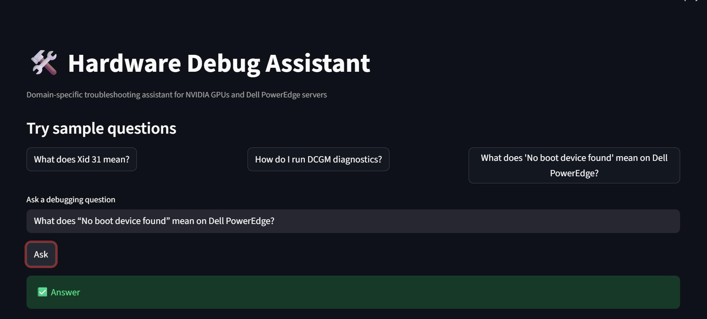
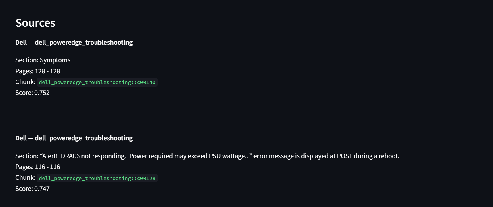

# Hardware Debug RAG Assistant

A domain-specific Retrieval-Augmented Generation (RAG) system for troubleshooting **Dell PowerEdge servers** and **NVIDIA GPUs** using vendor documentation.

The system ingests technical manuals, performs semantic retrieval using embeddings and a vector database, and generates grounded answers with citations.

---

## Motivation

Hardware troubleshooting documentation is often large and difficult to navigate quickly during incidents.

This project demonstrates how **LLMs combined with vector search** can create a technical assistant that retrieves the correct sections of vendor manuals and generates **grounded, traceable answers**.

---

## Features

- Document ingestion pipeline for technical manuals
- Chunking and metadata extraction
- Semantic search using embeddings
- Vector database retrieval (Qdrant)
- Evidence gating to reduce hallucinations
- Grounded LLM answers with citations
- FastAPI backend
- Streamlit UI
- Evidence viewer with similarity scores

---

## Architecture
# Hardware Debug RAG Assistant

A domain-specific Retrieval-Augmented Generation (RAG) system for troubleshooting **Dell PowerEdge servers** and **NVIDIA GPUs** using vendor documentation.

The system ingests technical manuals, performs semantic retrieval using embeddings and a vector database, and generates grounded answers with citations.

---

## Motivation

Hardware troubleshooting documentation is often large and difficult to navigate quickly during incidents.

This project demonstrates how **LLMs combined with vector search** can create a technical assistant that retrieves the correct sections of vendor manuals and generates **grounded, traceable answers**.

---

## Features

- Document ingestion pipeline for technical manuals
- Chunking and metadata extraction
- Semantic search using embeddings
- Vector database retrieval (Qdrant)
- Evidence gating to reduce hallucinations
- Grounded LLM answers with citations
- FastAPI backend
- Streamlit UI
- Evidence viewer with similarity scores

---

## Architecture
# Hardware Debug RAG Assistant

A domain-specific Retrieval-Augmented Generation (RAG) system for troubleshooting **Dell PowerEdge servers** and **NVIDIA GPUs** using vendor documentation.

The system ingests technical manuals, performs semantic retrieval using embeddings and a vector database, and generates grounded answers with citations.

---

## Motivation

Hardware troubleshooting documentation is often large and difficult to navigate quickly during incidents.

This project demonstrates how **LLMs combined with vector search** can create a technical assistant that retrieves the correct sections of vendor manuals and generates **grounded, traceable answers**.

---

## Features

- Document ingestion pipeline for technical manuals
- Chunking and metadata extraction
- Semantic search using embeddings
- Vector database retrieval (Qdrant)
- Evidence gating to reduce hallucinations
- Grounded LLM answers with citations
- FastAPI backend
- Streamlit UI
- Evidence viewer with similarity scores

---

## Architecture
User Question
↓
Streamlit UI
↓
FastAPI API
↓
Retriever (Embeddings Search)
↓
Qdrant Vector Database
↓
Evidence Pack
↓
OpenAI LLM (Grounded Answer Generation)
↓
Answer + Citations + Evidence

---

## Example Question
What does "No boot device found" mean on Dell PowerEdge?

Example Answer:

> After POST, the server cannot locate a bootable device.  
> This may occur when boot files cannot be located or when RAID virtual disks are offline.

Citations:
Dell PowerEdge Troubleshooting Guide – page 116

---

## UI Example

The UI displays:

- Generated answer
- Document citations
- Retrieved evidence chunks
- Similarity scores

---

## Technologies Used

- Python
- FastAPI
- Streamlit
- OpenAI API
- Qdrant
- Sentence Transformers (BGE embeddings)

---

## Running the Project

Clone the repository:
git clone https://github.com/yourname/rag-debug-system

cd rag-debug-system

Create virtual environment:
python -m venv venv

Install dependencies:
pip install -r requirements.txt

Create environment file:
cp .env.example .env

Add your OpenAI API key:
OPENAI_API_KEY=your_key_here

Run the system:
.\run_app.ps1

Open the UI:
http://localhost:8501
## Future Improvements

- Reranking model for better retrieval accuracy
- Logging and evaluation pipeline
- Containerized deployment
- Integration with hardware log files
- Multi-document collections for different vendors

---

## Author

Police Karthik Reddy  
Machine Learning Engineer

